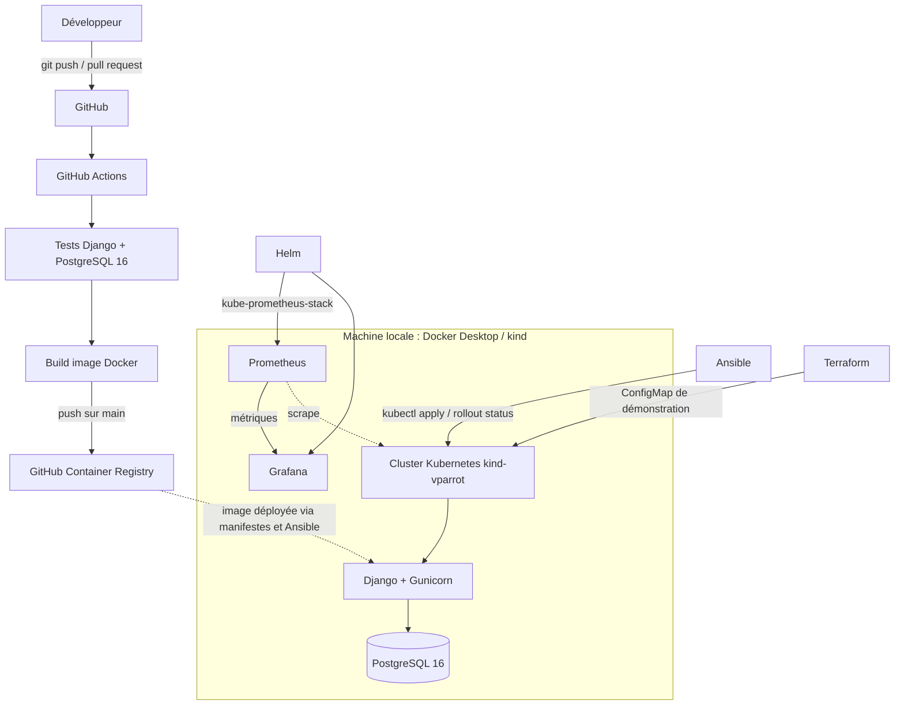

# VParrot — Django DevOps Project

**Projet portfolio DevOps : conteneurisation, intégration continue, orchestration Kubernetes, Infrastructure as Code, automatisation et observabilité.**

[Voir les pipelines GitHub Actions](https://github.com/SAnconina/VParrot-DevOpsProject-Django/actions)

> **Environnement cible :** laboratoire local sur Docker Desktop et Kubernetes `kind`. Il ne s'agit pas d'un déploiement cloud de production.

## Présentation

VParrot est une application web Django utilisant PostgreSQL. Ce dépôt illustre sa mise en œuvre dans un environnement DevOps complet, depuis les tests automatisés jusqu'à la supervision d'un cluster Kubernetes local.

L'objectif est de démontrer les compétences suivantes :

- Conteneuriser une application Django avec Docker et Gunicorn.
- Exécuter Django et PostgreSQL avec Docker Compose.
- Automatiser les tests, la construction et la publication d'images avec GitHub Actions.
- Déployer l'application sur un cluster local Kubernetes créé avec `kind`.
- Manipuler l'Infrastructure as Code avec Terraform et automatiser le déploiement avec Ansible.
- Installer et exploiter Prometheus et Grafana avec Helm.
- Examiner la sécurité des dépendances Python avec `pip-audit`.

## Architecture



**Important :** GitHub Actions automatise les tests, le build et la publication sur GHCR. Le déploiement sur le cluster `kind` local est déclenché séparément via Kubernetes/Ansible ; il n'est pas automatiquement effectué par le runner GitHub.

## Stack technique

| Domaine | Technologie | Usage |
| --- | --- | --- |
| Backend | Python, Django, Gunicorn | Application web |
| Base de données | PostgreSQL 16 | Stockage relationnel |
| Conteneurisation | Docker, Docker Compose | Images et environnement local |
| CI / publication | GitHub Actions, GHCR | Tests, build et publication de l'image |
| Orchestration | Kubernetes, `kind`, `kubectl` | Déploiement local |
| Infrastructure as Code | Terraform + provider Kubernetes | Gestion déclarative d'une ConfigMap de démonstration |
| Automatisation | Ansible | Déploiement et vérification du cluster |
| Observabilité | Helm, Prometheus, Grafana | Collecte et visualisation des métriques |
| Sécurité | `pip-audit` | Audit manuel des dépendances Python |

> Les versions exactes de Python et des bibliothèques sont celles de `Dockerfile`, `requirements.txt` et du workflow de la branche utilisée. La migration Python 3.12 / Django 5.2 a été testée localement ; elle doit être reflétée dans ces fichiers avant d'être présentée comme la version déployée.

## Structure du dépôt

```text
.
├── .github/workflows/       # Pipeline GitHub Actions
├── ansible/                 # Playbooks de déploiement et de vérification
├── backoffice/              # Application Django, tests
├── custom_user/             # Gestion des utilisateurs
├── k8s/                     # Manifestes Kubernetes
├── monitoring/              # Configuration Helm (values.yaml)
├── templates/               # Templates HTML
├── terraform/               # Configuration Terraform Kubernetes
├── vparrot/                 # Configuration du projet Django
├── Dockerfile
├── docker-compose.yml
├── manage.py
└── requirements.txt
```

## Prérequis

- Git et Docker Desktop
- Python compatible avec la version Django du dépôt
- `kubectl` et `kind` pour Kubernetes
- Helm pour le monitoring
- Terraform pour la démonstration IaC
- Ansible pour les playbooks

Sur une machine de développement, prévoyez suffisamment de RAM pour Docker Desktop : Prometheus et Grafana consomment des ressources supplémentaires.

## 1. Cloner le projet

```bash
git clone https://github.com/SAnconina/VParrot-DevOpsProject-Django.git
cd VParrot-DevOpsProject-Django
```

## 2. Exécuter avec Docker Compose

Le fichier `docker-compose.yml` définit les services `db` (PostgreSQL 16) et `web` (Django), ainsi qu'un volume persistant `postgres_data`.

Définissez localement le mot de passe PostgreSQL dans un fichier `.env` **non commité** :

```dotenv
POSTGRES_PASSWORD=remplacer-par-un-mot-de-passe-local
```

Démarrez les services :

```bash
docker compose up -d --build
docker compose ps
```

Exécutez les migrations Django :

```bash
docker compose exec web python manage.py migrate
```

Application : **http://localhost:8000**

Arrêter les services sans supprimer les données :

```bash
docker compose down
```

> Ne lancez pas `docker compose down -v` si vous souhaitez conserver les données PostgreSQL.

## 3. Intégration continue et publication des images

Le workflow **Django CI** est déclenché sur les `push` et `pull_request` vers `main`.

1. Lance PostgreSQL 16 comme service de test.
2. Installe Python et les dépendances.
3. Exécute `python manage.py check`.
4. Exécute `python manage.py test backoffice` (12 tests dans le projet testé).
5. Si les tests réussissent, construit l'image Docker.
6. Sur un `push` vers `main`, publie l'image sur GitHub Container Registry.

Images publiées :

```text
ghcr.io/sanconina/vparrot-devopsproject-django:latest
ghcr.io/sanconina/vparrot-devopsproject-django:<commit-sha>
```

[Consulter GitHub Actions](https://github.com/SAnconina/VParrot-DevOpsProject-Django/actions)

## 4. Déployer sur Kubernetes avec kind

Démarrez Docker Desktop, puis créez le cluster s'il n'existe pas déjà :

```bash
kind create cluster --name vparrot
kubectl get nodes --context kind-vparrot
```

**Ne recréez pas un cluster existant** si vous souhaitez préserver ses ressources et ses volumes.

Les manifestes se trouvent dans `k8s/`. Ils utilisent le namespace `vparrot` et des Secrets Kubernetes pour les valeurs sensibles (`DATABASE_URL`, `SECRET_KEY`, mot de passe PostgreSQL). **Les Secrets doivent être provisionnés localement avant le déploiement ; ne commitez pas leurs valeurs.**

Appliquez les manifestes :

```bash
kubectl apply --context kind-vparrot -f k8s/
kubectl get pods -n vparrot --context kind-vparrot
kubectl get services -n vparrot --context kind-vparrot
```

Pour rendre l'application accessible depuis le Mac :

```bash
kubectl port-forward --context kind-vparrot -n vparrot service/django 8080:8000
```

Application : **http://localhost:8080** (tant que le port-forward est actif).

### Migrations de base de données

Après un premier déploiement ou une évolution des modèles, les migrations doivent être effectuées dans l'environnement Kubernetes avec une procédure adaptée. Leur exécution n'est pas présentée ici comme automatiquement orchestrée par le pipeline CI.

## 5. Déploiement automatisé avec Ansible

Les playbooks utilisent le contexte Kubernetes `kind-vparrot`.

```bash
ansible-playbook -i localhost, -c local ansible/check-kubernetes.yml
ansible-playbook -i localhost, -c local ansible/deploy-kubernetes.yml
```

- `check-kubernetes.yml` vérifie le nœud et les Pods.
- `deploy-kubernetes.yml` applique les manifestes et contrôle la disponibilité des déploiements Django et PostgreSQL.

## 6. Infrastructure as Code avec Terraform

Le dossier `terraform/` utilise le provider Kubernetes et le contexte `kind-vparrot`. La configuration actuelle illustre la création d'une ConfigMap `vparrot-terraform-demo` dans le namespace `vparrot` ; elle ne provisionne pas un cluster cloud complet.

```bash
cd terraform
terraform init
terraform plan
terraform apply
cd ..
```

Le state Terraform est local. Les fichiers d'état et les variables sensibles ne doivent pas être publiés dans Git.

## 7. Monitoring avec Prometheus et Grafana

Le fichier `monitoring/values.yaml` personnalise le chart `kube-prometheus-stack` pour un cluster local peu doté en mémoire.

Ajouter le dépôt Helm :

```bash
helm repo add prometheus-community https://prometheus-community.github.io/helm-charts
helm repo update
```

Installer ou mettre à jour la stack :

```bash
helm upgrade --install monitoring prometheus-community/kube-prometheus-stack \
  --namespace monitoring \
  --create-namespace \
  --kube-context kind-vparrot \
  --version 92.18.0 \
  -f monitoring/values.yaml
```

Vérifier les Pods :

```bash
kubectl get pods -n monitoring --context kind-vparrot
```

Accéder à Grafana :

```bash
kubectl port-forward -n monitoring --context kind-vparrot service/monitoring-grafana 3000:80
```

Ouvrir **http://localhost:3000**. L'identifiant est `admin` ; récupérer le mot de passe **localement**, sans le publier :

```bash
kubectl get secret monitoring-grafana -n monitoring --context kind-vparrot \
  -o jsonpath='{.data.admin-password}' | base64 -d; echo
```

Des dashboards Kubernetes sont disponibles, notamment **Kubernetes / Compute Resources / Cluster**. Les métriques de mémoire, de réseau et de stockage ont été observées ; certains panneaux CPU et « commitment » peuvent encore afficher **No data** selon les métriques disponibles. Le monitoring actuel concerne principalement l'infrastructure Kubernetes, et non des métriques métier Django dédiées.

## 8. Tests et audit de sécurité

Tester Django :

```bash
python manage.py check
python manage.py test backoffice
```

Vérifier les versions installées et leurs contraintes :

```bash
python -m pip check
```

Auditer les dépendances :

```bash
pip-audit -r requirements.txt
```

Selon l'environnement Python et les anciennes versions présentes dans `requirements.txt`, cette commande peut nécessiter un environnement de test compatible et/ou un fichier de versions figées. L'audit réalisé pendant le projet a signalé des vulnérabilités dans Django, Pillow et sqlparse ; **ne pas considérer cet audit comme « vert » tant qu'une nouvelle analyse ne l'a pas confirmé sur les dépendances effectivement déployées**.

## Limites et pistes d'évolution

Ce dépôt constitue une **démonstration DevOps en environnement local**, pas une plateforme de production prête à exposer sur Internet. Parmi les améliorations possibles :

- Déploiement continu réel sur un cluster distant et stratégie de rollback.
- Gestion des Secrets via un gestionnaire dédié.
- Sauvegarde et restauration automatisées de PostgreSQL.
- Exécution contrôlée des migrations Django au déploiement.
- Sonde de santé, quotas et politiques de sécurité renforcés.
- Correction complète des fichiers média non inclus dans l'image Docker.
- Métriques applicatives Django et alertes Prometheus.
- Scans de sécurité automatiques dans la CI et audit final sans vulnérabilités connues.

## Auteur et dépôt

Projet DevOps VParrot — [SAnconina sur GitHub](https://github.com/SAnconina).

**Dépôt :** https://github.com/SAnconina/VParrot-DevOpsProject-Django

---
